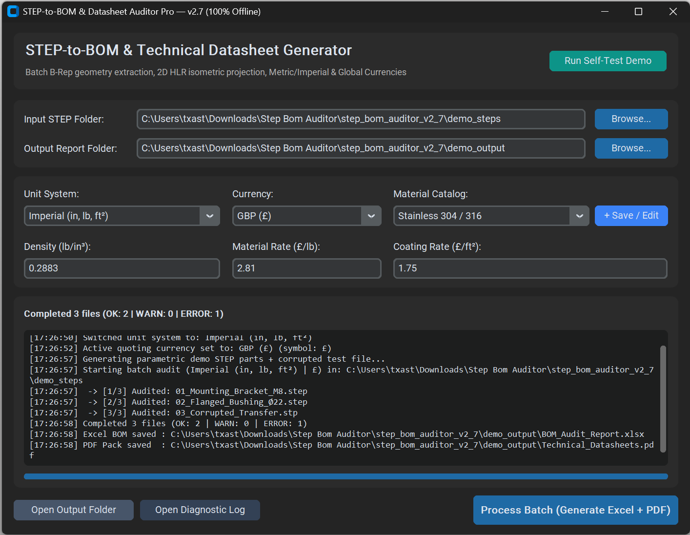
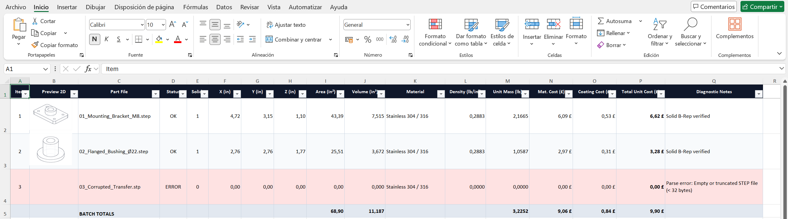
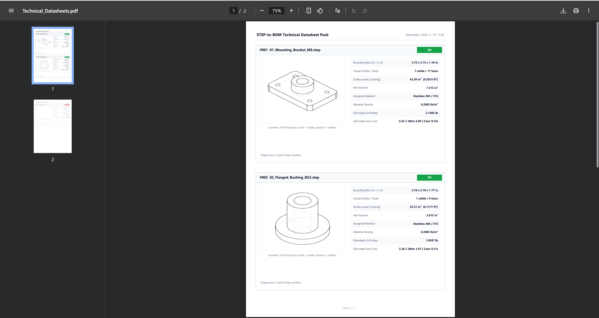

# STEP-to-BOM & Datasheet Auditor Pro (Windows 64-bit)

[-0078D6?style=for-the-badge&logo=windows)](https://cordarajavier.gumroad.com/l/tognwe)

> **Instant batch STEP-to-Excel BOM & PDF Technical Datasheet generator powered by an industrial OpenCascade B-Rep kernel. 100% offline, private, and ITAR/NDA-safe.**

---

## ⚡ Overview

Stop opening heavy CAD licenses (SolidWorks, Inventor, CATIA) or uploading confidential 3D parts to third-party cloud quoting portals just to extract bounding dimensions, surface areas, and component weights.

**STEP-to-BOM & Datasheet Auditor Pro** audits an entire folder of `.step` / `.stp` files in seconds, extracts true mathematical topology, renders 2D isometric Hidden-Line-Removal (HLR) projections, and compiles live **Excel BOM (`.xlsx`)** spreadsheets and **A4 Technical Datasheets (`.pdf`)**.

### 📥 Sample Output Downloads (Try Before Buying)

Inspect the actual files generated by the built-in self-test demo:
* [📄 Download Sample Excel BOM (`BOM_Audit_Report.xlsx`)](BOM_Audit_Report.xlsx)
* [📑 Download Sample Technical Datasheet (`Technical_Datasheets.pdf`)](Technical_Datasheets.pdf)
* [📖 Download Customer Quick-Start Guide (`QuickStart_Guide.pdf`)](QuickStart_Guide.pdf)

[👉 **Download Standalone Desktop Application (Portable ZIP)**](https://cordarajavier.gumroad.com/l/tognwe)

---

## 📸 Screenshots

### 1. Dark-Themed Desktop Interface
Batch processing with dual unit selection (Metric / Imperial), currency picker (USD, EUR, GBP, CAD, AUD, CHF), and integrated diagnostic logging.

### 2. Auto-Generated Excel BOM Report (`BOM_Audit_Report.xlsx`)
Complete with embedded 2D isometric thumbnails, bounding boxes, coating surface areas, volumes, unit masses, and live Excel pricing formulas (`=SUM(...)`).

### 3. A4 Technical Datasheet Pack (`Technical_Datasheets.pdf`)
Two clean part cards per page with 2D isometric projections distinguishing visible solid edges from dashed hidden lines, ready for shop-floor travelers or supplier RFQs.

---

## 🛠️ Key Capabilities

* **100% Offline Execution:** Zero cloud uploads. Your company's and clients' 3D CAD files never leave your local drive.
* **Dual Unit System Support:**
  * **Metric Mode:** Dimensions in mm, volume in cm³, surface area in cm² (and m² for coating), density in g/cm³, mass in kg.
  * **Imperial Mode:** Dimensions in inches, volume in in³, surface area in in² (and ft² for coating), density in lb/in³, mass in lbs.
* **Global Currency Quoting:** Choose between **USD ($)**, **EUR (€)**, **GBP (£)**, **CAD (CA$)**, **AUD (AU$)**, or **CHF (CHF)**. Excel formulas adapt automatically.
* **Exact B-Rep Geometry:** Extracts true geometric bounding box, net volume, surface area (ideal for painting, powder coating, anodizing, or electroplating quotes), and solid/face counts.
* **Persistent Material Catalog:** Pre-loaded with 10 standard industrial alloys and polymers (Carbon Steel, Stainless 304/316, Aluminum 6061/7075, Cast Iron GGG40, Brass, Titanium Grade 5, ABS, Nylon PA6, POM). Add, edit, or remove custom materials with one click.
* **Fault-Tolerant Engine:** Corrupted files or open surface shells are isolated, logged, and highlighted in yellow (`WARN`) or red (`ERROR`) without stopping the remaining batch.

---

## 💻 System Requirements

* **Operating System:** Windows 10 or Windows 11 (64-bit).
* **Dependencies:** None. Portable standalone software—does **not** require SolidWorks, AutoCAD, Python, or Microsoft Office installed.

---

## 🚀 Get Started

1. Purchase and download your portable copy on [Gumroad](https://cordarajavier.gumroad.com/l/tognwe).
2. Extract the downloaded ZIP to any directory.
3. Double-click `STEP_BOM_Auditor.exe` to run.
